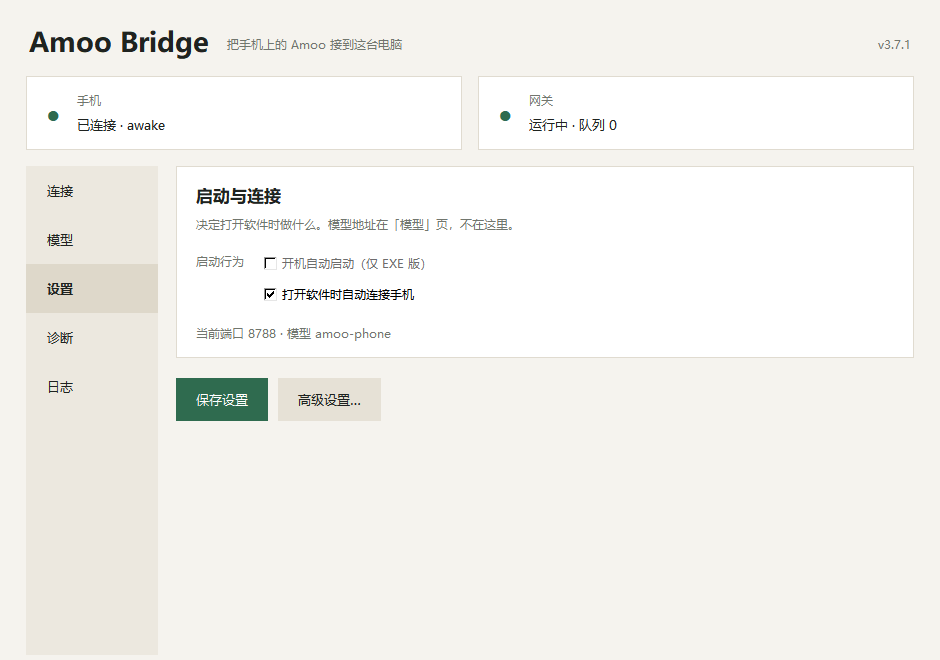
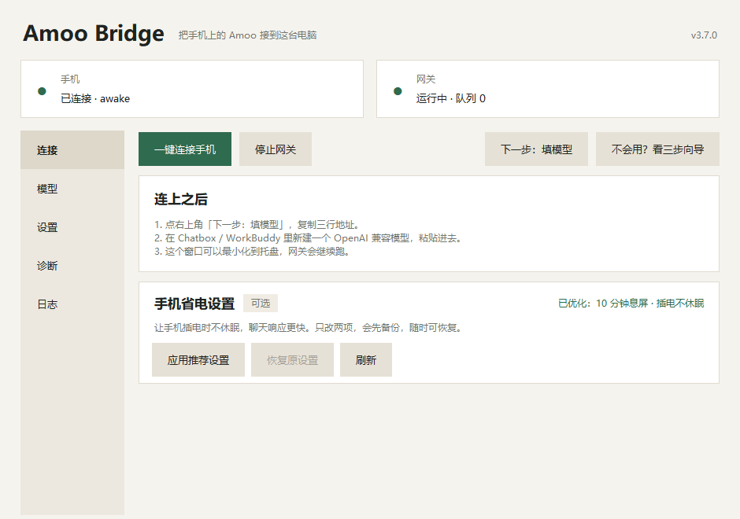

<div align="center">

<h1>Amoo Bridge</h1>

<p><strong>手机上那份额度，电脑上用不了。</strong></p>

<p>Amoo 的额度只能在手机里用，官方没有提供 API Key。Amoo Bridge 在 Windows 上开一个本机网关，OpenAI 兼容的客户端填三行就能用。</p>

<p>请求经 USB 进手机，额度仍从手机扣，电脑用多少手机扣多少。它不登录账号，也不改 Amoo。</p>

<p>
  
  
  
</p>

<p><code>¥14.9 一次付费</code> · <code>个人使用许可</code> · <code>Windows 10 / 11 64 位</code> · <code>需搭配 STEPX Neo</code></p>

<p>
  <a href="#为什么需要它">为什么需要</a> ·
  <a href="#它怎么工作">怎么工作</a> ·
  <a href="#能做什么">能做什么</a> ·
  <a href="#适合谁用">适合谁</a> ·
  <a href="#价格与获取">价格</a> ·
  <a href="#三步开始">三步开始</a> ·
  <a href="#支持哪些客户端">客户端</a>
</p>

</div>


<p align="center"><sub>你要做的全部配置，就是这三个值。</sub></p>

---

## 为什么需要它

STEPX Neo 先行版 3999 元，捆 12 个月、每月 100 亿 token。按阶跃开放平台同量级套餐价粗算，这份额度本身接近三千。

但它只认手机里的 Amoo，电脑上的客户端连不上。你花钱买的东西，落在了一块不干活的屏幕上。

手机上问零碎问题确实方便。写长一点就难受：改一段话要长按、选中、拖动，手指一抖就选多了；聊到十几轮想翻前面的记录，得一直往上滑。投屏试过，延迟能感觉到；把回答复制进文档接着写，上下文又断了，每次都得把前情再贴一遍。

Amoo 是在手机里跑的，电脑缺的只是一个入口。Amoo Bridge 把这个入口开出来：额度没搬家，只是从在手机里花，变成在电脑前花。扣的还是那份额度，计量以官方为准。

## 它怎么工作

**网关只跑在你这台电脑上，只监听本机回环地址，不经过任何第三方服务器，也没有账号体系。** 请求经 USB 进手机，回答原路回来。

```
手机（Amoo）
   │  USB
   ▼
Windows 电脑（Amoo Bridge 本机网关，只监听 127.0.0.1）
   │  Base URL / API Key / 模型名
   ▼
Chatbox · Cherry Studio · WorkBuddy · Cline 等 OpenAI 兼容客户端
```

只打通本机到手机这一段，别的什么都不代理，也不代表 Amoo 对外提供服务。

> 本仓库只放产品介绍、界面截图和更新说明，不含源码和安装包。

## 能做什么

### 连上就能用

装好打开，窗口里就三步：连手机、填模型、发一条测试消息。每一步写着该点哪里，不用翻文档。

填完当场就能发一条消息试。通了再往下用，不用猜自己配没配对。

窗口关掉不影响，网关照跑。你不必为了用它一直开着一个窗口。

### 不用一直盯着它

插头松了、手机睡过去，它自己接回来，不用你重开一遍。

默认端口被别的软件占了，它换一个接着跑。你不会看到报错，也犯不着去改设置。

手滑点开第二个，它把已有的窗口叫出来，不会起两个网关互相抢。

手机省电那两项是可选的，只动两个开关，界面上有恢复。

### 给愿意折腾的人

不想插线，可以在高级设置里切到无线调试。它会掉，所以日常还是建议插着线。

MCP 也是可选的，接外部工具时才用得上。界面里默认收起，普通聊天碰不到。



<p><sub>启动方式、端口和手机省电选项都在设置页。</sub></p>

## 适合谁用

**这些人用得最顺**：经常坐在电脑前，手机上的 AI 也用得多，手上正好是 STEPX Neo，额度在手机上用不完。写代码、写长文的人最典型。

## 价格与获取

**¥14.9，一次付费，个人使用许可。** 没有订阅，不按次计费。

买的是入口，不是额度。额度还在手机里，账号和计量都按原来的走，电脑这边只是多了一个能干活的地方。如果你每天都在电脑前写东西、写代码，它解决的就是每天都会遇到的那次卡顿。

安装包不走自动链接：付款后人工核验，用邮件发出，附件里带 SHA-256，你可以自己验一遍文件。

<details>
<summary>购买流程（三步，约两分钟）</summary>

| 微信支付 | 支付宝 |
|:---:|:---:|
|  |  |

1. **扫码支付 ¥14.9**，付款时备注你的邮箱。
2. **发邮件确认**：收件人 `matreshka999@icloud.com`，主题写 `[Amoo Bridge] 已付款`，正文附交易号（贴文字，别只发截图）、金额与付款时间。
3. **收安装包**：工作日 24 小时内、周末与节假日 48 小时内核验，回信附下载链接、SHA-256 校验值与安装说明。

</details>

## 三步开始

到这里你已经知道它是什么、多少钱了。剩下的问题只有一个：装起来要花多少力气。

| 项目 | 要求 |
|---|---|
| 电脑 | Windows 10 / 11，64 位 |
| 手机 | STEPX Neo，已安装 Amoo，并开启 USB 调试 |
| 连接 | 一根能传数据的 USB 线（只能充电的不行） |

### 第 1 步 · 连接手机

打开 Amoo Bridge，USB 线接上手机，点「一键连接手机」。手机上弹出 USB 调试授权时选允许。



连上后窗口顶部会显示「手机 已连接 · awake」和「网关 运行中 · 队列 0」。

### 第 2 步 · 复制三行配置

点「下一步：填模型」，把页面上的三个值抄下来：`Base URL`、`API Key`、`模型名`。

### 第 3 步 · 填进你的客户端

打开 Chatbox、Cherry Studio 或 WorkBuddy，新建一个 OpenAI 兼容的模型，把三行粘进去，发一条测试消息。

收到回复就算通了。之后窗口最小化到托盘，网关照跑。

第一次大约两分钟。之后每次用，只要插上线。

> 卡住了，点右上角「不会用？看三步向导」。

## 支持哪些客户端

凡是支持 OpenAI 兼容接口的工具都能用，填的都是同样三行：Base URL、API Key、模型名。

已经验过的是 Chatbox、Cherry Studio、WorkBuddy，以及 Cline、Continue、Aider 这几个编程工具。同类工具一般也能接上。

## 关于这个软件

这是第三方工具，不是 Amoo 官方产品，跟官方没有隶属、合作或授权关系。名字里带 Amoo，只是说明它给谁用。它不改 Amoo 本身，也不绕过账号、额度和付费机制，更不提供模型，只把本机到手机这一段打通。

软件闭源，源码和安装包都不公开，买的是个人使用许可。当前版本 v3.7.3，改动记在[提交历史](https://github.com/matreshka15/amoo-bridge-site/commits/main)里。

装不上、用起来有问题，回信说一声，能找着人。

**找谁**

- 订单、付款、安装包：`matreshka999@icloud.com`
- Bug 和功能建议：[Issues](https://github.com/matreshka15/amoo-bridge-site/issues)
- 使用问题、经验交流：[Discussions](https://github.com/matreshka15/amoo-bridge-site/discussions)

---

## 声明

Amoo Bridge 为付费软件，源码与安装包不公开。购买后获得个人使用许可，请勿转售、公开分发或反编译。

「Amoo」名称及相关商标、协议的权利归其权利人所有，本软件不主张任何相关权利。文中提及的各客户端名称仅用于说明兼容性，相关商标归各自所有者。

---

<p align="center"><sub>© 2026 Amoo Bridge · 独立第三方工具</sub></p>

<sub>Amoo Bridge 不是 Amoo 官方产品，与官方无隶属、合作或背书关系；不修改 Amoo 本身，不绕过其账号、额度或付费机制；不提供模型，也不代理任何第三方服务，只打通本机与手机之间的这一段链路。</sub>
