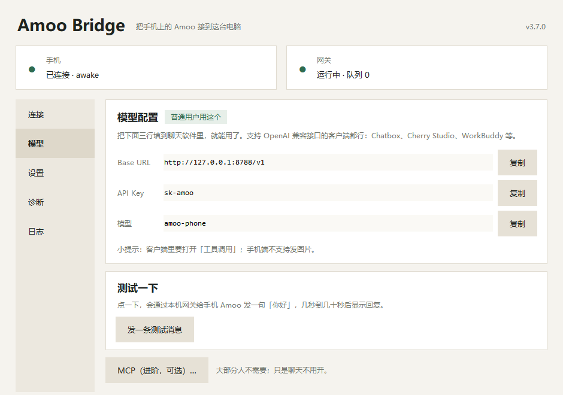

<div align="center">

<h1>Amoo Bridge</h1>

<p><strong>Amoo 没有对外开接口。这个工具在你自己的电脑上，补了中间那一层。</strong></p>

<p>一根能传数据的 USB 线把手机接到 Windows，本机起一个 OpenAI 兼容网关，客户端填三行就能用。<br>不修改 Amoo，也不碰它的账号、额度与付费机制；对话不经过我们的服务器。</p>

<p>
  
  
  
</p>

<p><code>¥14.9 一次付费</code> · <code>个人使用许可</code> · <code>Windows 10 / 11 64 位</code></p>

<p>
  <a href="#为什么需要它">为什么需要</a> ·
  <a href="#它怎么工作">怎么工作</a> ·
  <a href="#能做什么">能做什么</a> ·
  <a href="#价格与获取">价格</a> ·
  <a href="#三步开始">三步开始</a> ·
  <a href="#常见问题">常见问题</a>
</p>

</div>



<p align="center"><sub>你要做的全部配置，就是这三个值。</sub></p>

---

## 为什么需要它

改一段八百字的稿子，你在电脑上开好了编辑器，手指却要伸向手机。原文复制进 Amoo，等回复，再复制回来。改一轮四次，改三轮十二次。中间有一次忘了存，还得回去找。

手机上问出来的话，在电脑上找不到；电脑上整理好的上下文，手机里接不上。

Amoo 没有对外开接口，桌面客户端就看不见它。Amoo Bridge 补的是这一层：手机还是那台手机，客户端的模型列表里多了一个能选的来源。

它不提升 Amoo 的能力，只把"要拿手机"这件事去掉。

## 它怎么工作

**网关只跑在你这台电脑上，对话在你和手机之间直接往返，不经过我们的服务器，也没有账号体系。**

```
手机（Amoo）
   │  USB
   ▼
Windows 电脑（Amoo Bridge 本机网关）
   │  Base URL / API Key / 模型名
   ▼
Chatbox · Cherry Studio · WorkBuddy 等 OpenAI 兼容客户端
```

只打通本机到手机这一段，别的什么都不代理，也不代表 Amoo 对外提供服务。

> 本仓库只放产品介绍、界面截图、常见问题和更新说明，不含源码和安装包。

## 能做什么

### 连上就能用

装好打开，窗口里就三步：连手机、填模型、发一条测试消息。每一步写着该点哪里，不用翻文档。

填完当场就能发一条消息试。通了再往下用，不用猜自己配没配对。

窗口关掉不影响，网关照跑。你不必为了用它一直开着一个窗口。

### 不用一直盯着它

插头松了、手机睡过去，它自己接回来，不用你重开一遍。

默认端口被别的软件占了，它换一个接着跑。你不会看到报错，也犯不着去改设置。

手滑点开第二个，它把已有的窗口叫出来，不会起两个网关互相抢。

手机省电那两项是可选的，只动两个开关，界面上有恢复。

### 给愿意折腾的人

不想插线，可以在高级设置里切到无线调试。它会掉，所以日常还是建议插着线。

MCP 也是可选的，接外部工具时才用得上。界面里默认收起，普通聊天碰不到。


<p><sub>启动方式、端口和手机省电选项都在设置页。</sub></p>

## 价格与获取

**¥14.9，一次付费，个人使用许可。** 没有订阅，不按次计费。

安装包不走自动链接：付款后人工核验，用邮件发出，附件里带 SHA-256，你可以自己验一遍文件。

<details>
<summary>购买流程（三步，约两分钟）</summary>

| 微信支付 | 支付宝 |
|:---:|:---:|
|  |  |

1. **扫码支付 ¥14.9**，付款时备注你的邮箱。
2. **发邮件确认**：收件人 `matreshka999@icloud.com`，主题写 `[Amoo Bridge] 已付款`，正文附交易号（贴文字，别只发截图）、金额与付款时间。
3. **收安装包**：工作日 24 小时内、周末与节假日 48 小时内核验，回信附下载链接、SHA-256 校验值与安装说明。

</details>

**关于"未知发布者"**

安装包没有代码签名，Windows 第一次运行会提示"未知发布者"。这是预期行为，不是文件被改过。不放心的话，回信里附的 SHA-256 可以在本机比对：

```
certutil -hashfile 安装包.exe SHA256
```

要是提示里出现的是某个具体公司名，而不是"未知发布者"，先停下来回信确认。

## 三步开始

到这里你已经知道它是什么、多少钱了。剩下的问题只有一个：装起来要花多少力气。

| 项目 | 要求 |
|---|---|
| 电脑 | Windows 10 / 11，64 位 |
| 手机 | 已安装 Amoo，并开启 USB 调试 |
| 连接 | 一根能传数据的 USB 线（只能充电的不行） |

### 第 1 步 · 连接手机

打开 Amoo Bridge，USB 线接上手机，点「一键连接手机」。手机上弹出 USB 调试授权时选允许。


连上后窗口顶部会显示「手机 已连接 · awake」和「网关 运行中 · 队列 0」。

### 第 2 步 · 复制三行配置

点「下一步：填模型」，把页面上的三个值抄下来：`Base URL`、`API Key`、`模型名`。

### 第 3 步 · 填进你的客户端

打开 Chatbox、Cherry Studio 或 WorkBuddy，新建一个 OpenAI 兼容的模型，把三行粘进去，发一条测试消息。

收到回复就算通了。之后窗口最小化到托盘，网关照跑。

第一次大约两分钟。之后每次用，只要插上线。

> 卡住了，点右上角「不会用？看三步向导」。

## 关于这个软件

这是第三方工具，不是 Amoo 官方产品，跟官方没有隶属、合作或背书关系。它不改 Amoo 本身，也不绕过账号、额度和付费机制，更不提供模型，只把本机到手机这一段打通。

软件闭源，源码和安装包都不公开，买的是个人使用许可。当前版本 v3.7.3，改动记在[提交历史](https://github.com/matreshka15/amoo-bridge-site/commits/main)里。

接口用的是 OpenAI 兼容标准，所以你换客户端，不用换工具。

**已知限制**（先说清楚，省得装完才发现）

- 只支持 Windows 10 / 11 64 位，Mac 和 Linux 还在看，没有时间表
- 无线模式会掉线，日常建议插着线
- 手机端要开 USB 调试，只能充电的线不行
- 安装包未签名，首次运行会提示"未知发布者"

**找谁**

- 订单、付款、安装包：`matreshka999@icloud.com`
- Bug 和功能建议：[Issues](https://github.com/matreshka15/amoo-bridge-site/issues)
- 使用问题、经验交流：[Discussions](https://github.com/matreshka15/amoo-bridge-site/discussions)

## 常见问题

### 能不能装

**需要会写代码吗？**

不需要。装好打开，跟着「三步向导」点下去就行，全程没有命令行，也不用编辑配置文件。

**支持哪些客户端？**

凡是支持 OpenAI 兼容接口的工具都能用。常见的有 Cherry Studio、Chatbox、NextChat、LobeChat、沉浸式翻译、Cursor、VS Code（Cline / Continue）、Obsidian 插件等。填的都是同样三行：Base URL、API Key、模型名。

**支持 Mac 或 Linux 吗？**

当前版本只支持 Windows 10 / 11 64 位，其他平台还在评估。

**手机一定要插着线吗？**

默认走数据线，最稳。线必须能传数据，只能充电的不行。想在局域网里无线用，可在「高级设置」取消「只用数据线」，按说明连一次无线调试；无线会掉线，日常还是建议插线。

### 会不会坏

**连接断了怎么办？**

桌面端会自动重连。一直连不上就重新插一下线，或者到「诊断」页看状态。

**端口被占用了怎么办？**

不用管，程序会自动换一个可用端口。

**数据会经过你们的服务器吗？**

不会。网关只在本机监听，请求经 USB 直接到手机。我们没有可以中转的服务器，也看不到你的对话内容。

### 钱和货

**为什么安装包要人工发？**

源码与安装包不公开，按订单人工核验后发放，避免被二次分发。这也是目前唯一的分发方式。

**付款后多久能收到？**

工作日 24 小时内、周末与节假日 48 小时内。超过这个时间没收到，直接回信催一次，附上交易号即可。

**装不上或者用不了怎么办？**

回信说明情况，附上报错截图和系统版本，一起看是环境问题还是软件问题。

### 以后

**会不会以后不更新了，或者哪天线就断了？**

接口走的是 OpenAI 兼容标准：客户端换了你不用换工具；手机端要是改了，会先在提交记录里说明。风险没法承诺为零，但这一层做得很薄，真出问题改动也小。

**订单与安装问题发在哪？**

走邮件：`matreshka999@icloud.com`。订单号、邮箱、付款截图、安装包链接请不要发到 Issue 或 Discussion，公开区只讨论可复现的软件问题和功能建议。

---

## 声明

Amoo Bridge 为付费软件，源码与安装包不公开。购买后获得个人使用许可，请勿转售、公开分发或反编译。

「Amoo」名称及相关商标、协议的权利归其权利人所有，本软件不主张任何相关权利。文中提及的各客户端名称仅用于说明兼容性，相关商标归各自所有者。

---

<p align="center"><sub>© 2026 Amoo Bridge · 独立第三方工具</sub></p>

<sub>Amoo Bridge 不是 Amoo 官方产品，与官方无隶属、合作或背书关系；不修改 Amoo 本身，不绕过其账号、额度或付费机制；不提供模型，也不代理任何第三方服务，只打通本机与手机之间的这一段链路。</sub>
