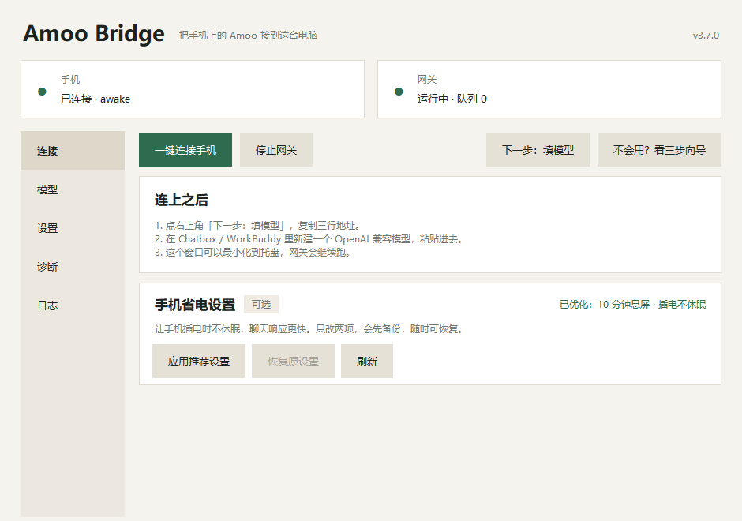
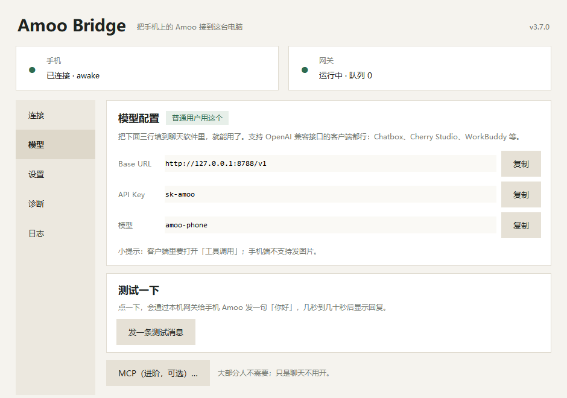
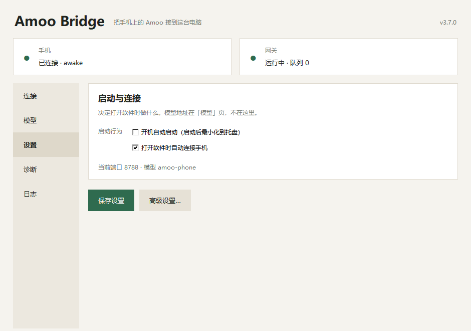

<div align="center">

<h1>Amoo Bridge</h1>

<p><strong>把手机上的 Amoo 接到 Windows 电脑。</strong><br>
在本机开一个网关，Chatbox、Cherry Studio、WorkBuddy 等 OpenAI 兼容客户端填三行就能用。</p>

<p>
  
  
  
  
</p>

<p>
  <a href="#功能">功能</a> ·
  <a href="#三步开始">三步开始</a> ·
  <a href="#界面">界面</a> ·
  <a href="#获取软件">获取软件</a> ·
  <a href="#常见问题">常见问题</a>
</p>



</div>

## 这是什么

Amoo Bridge 是一个 Windows 桌面小工具，解决一件事：**让电脑上的聊天客户端用上你手机里的 Amoo。**

它通过 USB 把手机连到电脑，在本机开一个网关。客户端按 OpenAI 兼容格式填三行——Base URL、API Key、模型名——就能把对话发到手机上的 Amoo。

不用命令行，不用改配置文件，打开窗口点几下就行。

```
手机（Amoo）
   │  USB
   ▼
Windows 电脑（Amoo Bridge 本机网关）
   │  Base URL / API Key / 模型名
   ▼
Chatbox · Cherry Studio · WorkBuddy 等 OpenAI 兼容客户端
```

> 本仓库只放产品介绍、截图、常见问题和更新说明，**不包含源码和安装包**。

## 功能

|  |  |
|---|---|
| **三步向导**<br>连接手机、填模型、测试，跟着窗口提示走 | **托盘常驻**<br>窗口关了也不影响，网关继续跑 |
| **断线自动重连**<br>线松了、手机休眠，会自动连回来 | **端口冲突自动换**<br>默认端口被占，自动换一个 |
| **发一条测试消息**<br>配置完当场验证，通了再开始用 | **手机省电设置**<br>可选，只改两项，随时能恢复 |
| **单实例**<br>重复打开只唤起已有窗口，不会起两个网关 | **MCP（可选）**<br>进阶功能，普通聊天用不到，默认收起 |

## 三步开始

### 准备

- Windows 10 / 11 64 位电脑
- 手机上安装 Amoo，并在系统设置里开启 USB 调试
- 一根**能传数据**的 USB 线（只能充电的线不行）

### 第 1 步：连接手机

安装并打开 Amoo Bridge，用 USB 线把手机接到电脑，点「一键连接手机」。手机上弹出 USB 调试授权时选允许。

连上后，窗口顶部会显示「手机 已连接 · awake」和「网关 运行中 · 队列 0」。

### 第 2 步：复制三行配置

点「下一步：填模型」，复制页面上的三行：

`Base URL` · `API Key` · `模型名`

### 第 3 步：填进你的客户端

打开 Chatbox / Cherry Studio / WorkBuddy，新建一个 OpenAI 兼容的模型，把三行粘贴进去，发一条测试消息。

收到回复就说明通了。之后窗口可以最小化到托盘，网关会继续运行。

> 卡住了就点右上角「不会用？看三步向导」。

## 界面

| 连接页 | 模型页 | 设置页 |
|:---:|:---:|:---:|
|  |  |  |
| 手机和网关状态都在这页，绿点表示正常 | 三行配置在这里复制，直接粘进客户端 | 启动方式与端口设置，按需调整 |

## 系统要求

| 项目 | 要求 |
|---|---|
| 电脑 | Windows 10 / 11，64 位 |
| 手机 | 安装 Amoo，并开启 USB 调试 |
| 连接 | 一根能传数据的 USB 线 |

## 获取软件

**¥14.9** · 个人使用

| 微信支付 | 支付宝 |
|:---:|:---:|
|  |  |

付款时备注你的邮箱；付款后发邮件到 **matreshka999@icloud.com**，主题写 `[Amoo Bridge] 已付款`。

### 购买步骤

1. **扫码支付 ¥14.9**：微信或支付宝，付款时备注你的邮箱。
2. **发邮件确认**：附上交易号（请粘贴文字，不要只发截图）、金额、付款时间和截图。
3. **收下载链接**：工作日 24 小时内、周末与节假日 48 小时内核验；通过后发安装包下载链接、SHA-256 和安装说明。下载安装后按上面的「三步开始」连接手机。

> 当前版本没有在线激活或机器绑定，安装包请勿转发给他人。安装包暂未做代码签名，Windows 首次运行可能提示「未知发布者」。

## 常见问题

<details>
<summary><b>需要会写代码吗？</b></summary>
<p>不需要。装好打开，按「三步向导」点下去就行，全程没有命令行。</p>
</details>

<details>
<summary><b>MCP 是什么？必须开吗？</b></summary>
<p>MCP 是进阶功能，给需要接入外部工具的人用。普通聊天完全不需要，界面里默认收起。</p>
</details>

<details>
<summary><b>支持 Mac 或 Linux 吗？</b></summary>
<p>当前版本只支持 Windows 10 / 11 64 位。</p>
</details>

<details>
<summary><b>手机一定要用线连着吗？</b></summary>
<p>需要一根能传数据的 USB 线把手机接到电脑，只能充电的线不行。</p>
</details>

<details>
<summary><b>连接断了怎么办？</b></summary>
<p>桌面端会自动重连。如果一直连不上，重新插一下数据线，或到「诊断」页看看状态。</p>
</details>

<details>
<summary><b>端口被占用了怎么办？</b></summary>
<p>不用管，程序会自动换一个可用端口。</p>
</details>

<details>
<summary><b>支持哪些客户端？</b></summary>
<p>凡是支持 OpenAI 兼容接口的客户端都可以，例如 Chatbox、Cherry Studio、WorkBuddy。填的都是同样三行：Base URL、API Key、模型名。</p>
</details>

<details>
<summary><b>为什么下载不到安装包？</b></summary>
<p>源码和安装包不公开，按订单人工发放。按上面「获取软件」扫码付款后发邮件确认即可。</p>
</details>

<details>
<summary><b>能开发票吗？</b></summary>
<p>在购买邮件里说明开票需求，能否开具和具体类型以回信确认为准。</p>
</details>

<details>
<summary><b>订单或安装问题可以发在 Issue 里吗？</b></summary>
<p>不可以。订单、付款截图、邮箱、安装包链接只通过邮件处理。公开区只讨论可复现的软件问题和功能建议。</p>
</details>

## 版本与更新

- 当前版本：**v3.7.0**
- 更新动态：[Releases](https://github.com/matreshka15/amoo-bridge-site/releases)
- 使用问题：[GitHub Discussions](https://github.com/matreshka15/amoo-bridge-site/discussions)
- Bug / 功能建议：[GitHub Issues](https://github.com/matreshka15/amoo-bridge-site/issues)
- 订单、付款、安装包：**matreshka999@icloud.com**

公开区请勿粘贴订单号、邮箱、付款截图或安装包链接。

## 许可与声明

Amoo Bridge 为付费软件，源码与安装包不公开。购买后获得个人使用许可，请勿转售、公开分发或反编译。

「Amoo」名称及相关商标、协议的权利归其权利人所有。Amoo Bridge 是独立第三方工具，与 Amoo 官方无隶属、合作或背书关系。

文中提到的 Chatbox、Cherry Studio、WorkBuddy 等名称仅用于说明兼容性，相关商标归各自所有者。

---

<div align="center">
<sub>© 2026 Amoo Bridge · 独立第三方工具，与 Amoo 官方无隶属或合作关系</sub>
</div>
